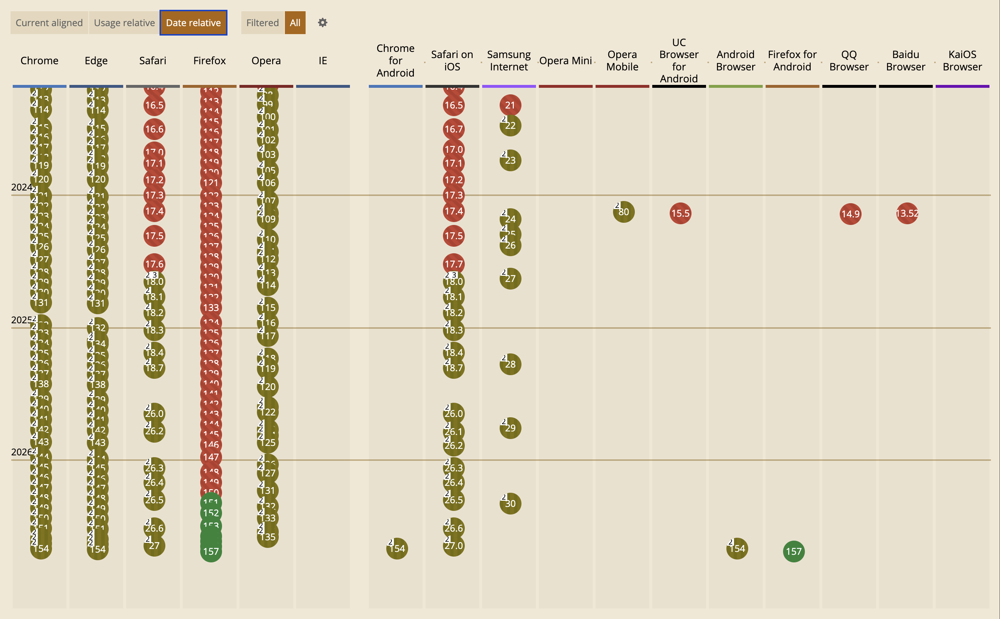
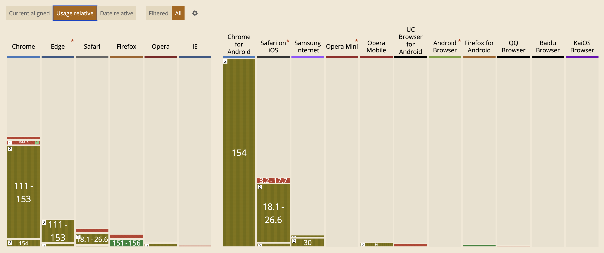

<script src="https://esm.sh/nudeui@0.0.5/html-demo?raw" type="module"></script>
<!-- <script src="http://localhost:8002/nudeui/nudeui/components/html-demo/html-demo.js" type="module"></script> -->

I've always had a soft spot for icons[^1].
Not only do they add polish to a UI, they can also tangibly improve usability.
Familiar icons help users find what they need quickly, since we recognize pictures much faster than we read words.

[^1]: There’s a small chance I may have been [the first to use a web font for UI icons](https://lea.verou.me/blog/2010/02/iphone-keyboard-with-css3-no-images/), in 2010.
I even worked as [Product Lead at Font Awesome](https://lea.verou.me/blog/2024/awesome/) for a bit.

And as a web architect at heart, the current dominant ways we have to include icons on the Web make me sad.
While there are many, [_many_](https://nucleoapp.com/blog/post/guide-to-importing-svg-icons-in-html) different ways to include icons in a Web UI, each with different [performance characteristics](https://cloudfour.com/thinks/svg-icon-stress-test/), by far the most common ones involve adding inline SVG to the HTML.
For example, a [trash icon](https://lucide.dev/icons/trash) might be included like this:

<html-demo isolate buttons="open codepen">

```html
<button>
<svg xmlns="http://www.w3.org/2000/svg" width="24" height="24" viewBox="0 0 24 24" fill="none" stroke="currentColor" stroke-width="2" stroke-linecap="round" stroke-linejoin="round" class="lucide lucide-trash preview-icon"><path d="M10 11v6"/><path d="M14 11v6"/><path d="M19 6v14a2 2 0 0 1-2 2H7a2 2 0 0 1-2-2V6"/><path d="M3 6h18"/><path d="M8 6V4a2 2 0 0 1 2-2h4a2 2 0 0 1 2 2v2"/></svg>
Delete
</button>
```
<style slot="demo">
	@import url('styles.css');
	button svg {
		vertical-align: -.1em;
		height: 1em;
	}
</style>
</html-demo>

Some people use a separate SVG file for sanity and include icons via `<use>`, but the markup is still fairly clunky (not to mention slow, sans bundlers).
All this clunkiness forces people to resort to hiding the icon under layers of abstraction, such as dedicated custom elements like `<x-icon name="trash"></x-icon>` or React components like `<TrashIcon />`,
but the ugliness still ships under all these layers, and the browser still has to deal with it.

Icon fonts _did_ put icons in CSS (`::before { content: "\f1f8" }` is still how [Font Awesome’s pseudo-element mode](https://docs.fontawesome.com/web/add-icons/pseudo-elements) works), and a lot of their appeal was exactly that.
But they came with [a long list of issues](https://cloudfour.com/thinks/seriously-dont-use-icon-fonts/):
large downloads (even with subsetting), fallback glyphs when the font fails to load, screen readers announcing private-use codepoints, user font overrides (e.g. for dyslexia) wiping them out, and text hinting that was never designed for pictures.
We threw out the baby with the bathwater: the problem was the font, not the CSS.

Many of the [attempts](https://antfu.me/posts/icons-in-pure-css) to move this to CSS still involve markup.
The mask trick that most of them rely on is not new either: Chen Hui Jing [covered it](https://chenhuijing.com/blog/the-many-methods-for-using-svg-icons/) in 2021, and [Iconify generates mask-based CSS](https://iconify.design/docs/usage/css/) for its entire catalog.
But in all of these, _which_ icon to use (and whether to use one at all) is still decided in the markup, via one class per icon; CSS only handles color.
The closest I’ve seen is David Bushell’s 2024 post on [including icons purely via CSS](https://dbushell.com/2024/01/19/svg-icons-with-css-masks/) via generated content + masks, where the icon _is_ picked in CSS, but every selector that wants to support icons needs its own chunk of CSS, and there is no way to override the icon on a case by case basis.
I still think it’s superior to inline SVG in HTML, and it baffles me why it isn’t more popular.

## A user-centered icon system

Per the principles outlined in [my user effort article](../user-effort), a good icon system should:
1. **keep syntax close to the minimum necessary to declare intent**, and
2. **make simple things easy, complex things possible, and the transition from one to the other smooth (no usability cliffs)**

How does that translate to an icon system?

- **High signal-to-noise ratio:** The intent to add or override an icon is basically "icon" plus the icon name, and possibly its location (start, end, marker, etc). Anything beyond that is boilerplate. Some boilerplate is unavoidable, but most `<svg>`-based solutions involve unacceptable amounts of boilerplate (which is why we end up abstracting that away).
- **Simple things should be easy:**
	- We should be able to define default icons for certain cases without having to explicitly include them at every callsite. E.g. a `<button class="delete">` should automatically get a trash icon, without needing to declare it in the markup in any way, shape, or form, unless we want to override it.
	- The default icon color should follow the local text color (or designated icon color, if different) without any additional song and dance.
- **Complex things should be possible:**
	- We should be able to easily override the default icon for a component, either permanently or as a result of various conditions (state changes, user interaction, etc.).
	- Styling the icon should be as easy as applying a CSS property. The minimum is color, but the more extensive styling is possible, the better.
- **No usability cliffs:** Overridding an icon, temporarily or permanently, should still not require much more than the bits of information necessary to declare intent.

Per [consumers > producers](../../2025/user-effort/#consumers-over-producers), making icon _usage_ ergonomic is more important than making icon _definition_ ergonomic, but ideally adding a new icon to the icon system should not require much more than:
- declaring the name of the icon, and
- providing the SVG path data or a URL to an SVG file

And of course, it still needs to be reasonably performant — the existing success criteria don't disappear!

**The dominant ways to include icons today fail to meet at least one of these criteria.**
Can we do better?

## Why CSS?

**CSS is the only web platform language that facilitates _reactive aggregation_**: you declare what applies to what conditions (type of element, interaction state, media query, etc.) and the browser automatically applies the right styles when those conditions are met and cleanly removes them when they are no longer met, without affecting any other conditions that simultaneously apply to the element, and without forcing developers to manage any of these side effects manually.

_I personally think we are underutilizing this wonderful language by artificially restricting it to styling, but that's a topic for another article._

If we can nail icons via CSS, this gives us **tremendous expressive power, with practically no loss of flexibility.**

Imagine being able to tweak icons based on…
- Any selector, including interaction pseudo-classes (`:hover`, `:focus`, etc.), e.g. to communicate additional information about the action or adapt to a different background color
- Media queries (`print`, dark mode, high contrast, etc), e.g. use different icons in dark mode, add or remove them in print, etc.
- Container queries
- Writing mode, e.g. to use a different icon for RTL text

Additionally, if icons can be injected or tweaked via CSS, this means we can specify them on pseudo-elements, such as `details::marker`, `select::picker-icon`, or `option::checkmark`, something no markup solution accommodates.

Or even, imagine applying **entirely different icon sets to the entire page** (or a portion) without having to touch any markup!
E.g. a section with a hand-drawn aesthetic could get a hand-drawn icon set, without affecting the rest of the UI.

The possibilities are endless.
Once you allow yourself to consider that this is possible, you will start seeing use cases everywhere.

### Icons should be design tokens

Including icons as direct `<svg>`s (especially with no wrapping abstraction to manage a shared registry) means there is no way to enforce consistency — anything goes.
One page might use a Font Awesome trash icon, another might use a Lucide trash icon.

I think the icons _themselves_ should be a type of design token, managed by the design system, that UI components simply use, just like colors and gradients.

Managing icons via CSS also allows us to define them alongside other design tokens (e.g. as CSS variables on `:root`), rather than in a separate place.

## What does it look like?

Suppose icons were CSS variables, and we could add an icon to an element simply by setting an `--icon` custom property, e.g. by doing something like

```html
<button style="--icon: var(--icon-trash)">Delete</button>
```

This means we could also make simple things easy via:

```css
button.delete {
  --icon: var(--icon-trash);
}
```

while maintaining the ability to override the icon on a case by case basis by simply overridding the `--icon` property.

We can even adapt to state reactively:

```css
button.delete {
	--icon: var(--icon-trash-outlined);

	@media (prefers-color-scheme: dark) {
		--icon: var(--icon-trash-filled);
	}

	&:hover {
		background: var(--color-danger);
		/* See https://lea.verou.me/blog/2024/contrast-color/
			for making it adapt automatically */
		color: var(--color-danger-text);
	}
}

a[href^="https://"] {
	@media print {
		--icon-end: var(--icon-link-external);
	}
}
```

or user interaction, e.g. to communicate both _where_ a link goes (GitHub) and _what_ it is (an external link):

```css
a.github {
	--icon: var(--icon-github);

	&:hover {
		--icon: var(--icon-link-external);
	}
}
```

And for completely ad hoc standalone icons where adding CSS would be _more_ work than doing it inline in HTML, we can have an `.icon` class:

```html
<i class="icon" style="--icon: var(--icon-trash)"></i>
```

This makes it **strictly _more_ powerful than the markup approaches**,
with the only exception being that completely inline SVG allows potentially changing the SVG itself in arbitrary ways (e.g. morphing it into another icon or changing it dynamically as the result of user input).
For those cases, we’d still need inline SVGs.
But how many of your icons fall in that category?

## How it works

### The core idea

Icons are inserted via pseudo-elements, which use the icon to mask a square with `background` equal to the icon color.

The referencing syntax I’ve settled on is:
- Low-level `--icon-[location]` properties:
  - `--icon-start` to prepend an icon to element contents (via `::before`)
  - `--icon-end` to append an icon to element contents (via `::after`)
  - Optionally, additional properties can redirect to other pseudo-elements, e.g. `--icon-marker` for `::marker`
- `--icon` higher level abstraction that just means "add an icon to this component": components[^components] can redirect it to any of the lower-level `--icon-[location]` properties on the element itself or a descendant depending on what makes sense for that component. E.g. `--icon` may set `--icon-start` on a `<button>` but `--icon-marker` on `<summary>`

[^components]: I’m using "components" here in the general sense of a reusable UI element, not in the sense of a framework component or a custom element. E.g. a styled `<button>` or an `<article class="callout">` would qualify.

You could be more elaborate and also define `--icon-[state]` properties like `--icon-hover`, `--icon-focus` etc, if you deem them useful!
The beauty of this approach is its immense flexibility.

Available icons are defined on `:root` as CSS variables, e.g.:

```css
:root {
	/* Embedded, for performance */
	--icon-trash: url("data:image/svg+xml,<svg viewBox='0 0 448 512' xmlns='http://www.w3.org/2000/svg'><path d="…"></svg>");

	/* Remote SVGs work fine too! */
	--icon-link-external: url("icons/link-external.svg");

	/* more icons here */
}
```

<article class=note>

One-off icons can still be used by setting e.g. `--icon: url(…)` instead of `--icon: var(--icon-foo)`, but if most UI references registered icons, they will stand out like a sore thumb and will be easy to spot in a review.
</article>

Then, to display these as icons, the crux is:
- An empty pseudo-element e.g. `::before` or `::after` is used to display the icon
- The pseudo-element is painted as a `1em` square with `background: currentColor`
- A CSS `mask` masks the square in the shape of the icon (_But, but, but …browser support?!?_ Fear not! [Masks are actually Baseline Widely Available](https://developer.mozilla.org/en-US/docs/Web/CSS/Reference/Properties/mask) nowadays)
- A CSS property (`--icon-start` or `--icon-end`) is used to specify the icon to display, instead of an ad hoc one like `--arrow`. This means we can set any element's icon from any place that accepts declaration, including via inline styles

<article class="important">

For simplicity, I will only discuss `--icon-start`/`::before` in the rest of this section,
but everything applies identically to `--icon-end`/`::after` and any additional ones.
</article>

```css
::before {
	content: "";
	display: inline-block;
	width: 1em;
	height: 1em;
	background-color: currentColor;
	mask: var(--icon-start) no-repeat center / contain;
}
```

<article class="note">

#### Why not use `aspect-ratio`?

You may be wondering why I'm specifying the size twice instead of `width: 1em; aspect-ratio: 1`.
Flex items stretch by default, and a stretched size is definite, so `aspect-ratio` is ignored.
Since icons so often live in buttons, and buttons are so often `display: flex`, an explicit `height` is far more robust.
Grid happens to be fine (`align-self: normal` behaves as `start` for items with an aspect ratio), but flex has no such exception.
</article>

Unfortunately, you need to repeat the pseudo-element contents for every type of pseudo-element you want to be able to support icons on.
[Mixins](#mixins) will eventually fix that.

### Restricting it to only elements that actually have an icon

As described above, this would apply to _all_ elements, which is far from ideal!

We can use a [style query](https://developer.mozilla.org/en-US/docs/Web/CSS/Guides/Containment/Container_size_and_style_queries) ([finally Baseline! 🎉](https://web-platform-dx.github.io/web-features-explorer/features/container-style-queries/)) to restrict this to only elements with the `--icon-start` property set:

```css
@container style(--icon-start) {
	::before {
		/* same as above * /
	}
}
```

We would also need to register `--icon-start` as non-inheriting via `@property`,
otherwise any container with an icon would sprout an icon for every single descendant (including inline formatting like `<strong>`, `<em>` etc!),
which we _definitely_ don't want.

```css
@property --icon-start {
	syntax: '*';
	inherits: false;
}
```

And then just explicitly inherit them in the pseudo-element:

```css
@container style(--icon-start) {
	::before {
		--icon-start: inherit;
		/* same as above * /
	}
}
```

### But can I _really_ depend on style queries?

Style queries are [Baseline 2026](https://web-platform-dx.github.io/web-features-explorer/features/container-style-queries/), which sounds quite cutting edge.
However, if you look at market share, it is supported in ~93% of users’ browsers worldwide per [Can I Use](https://caniuse.com/css-container-queries-style) data.
While this data under-represents old Chrome Android (it lumps all Chrome Android under its latest version), Chrome shipped style queries in 2023 (in version 111) and [Chrome Mobile users do seem to upgrade pretty quickly](https://rumarchive.com/insights/#ua-version-marketshare), so the real number won't be meaningfully lower.

How is this possible? If you sort by date, you will see that all major browsers _except_ Firefox had shipped style queries by 2024.
Firefox was the last one to ship them, in May 2026.



Now, let's see the Usage relative chart:



**Firefox _as a whole_ accounts for 2.28% of worldwide market share.**

Now, I’m not saying ignore Firefox because of its low market share!
That would be a d*ck move, comparable to making UIs inaccessible because screen reader users are a minority.
**Some things matter more than their raw numbers might indicate**, and not excluding Firefox is _essential_ for the Web to remain open, interoperable, and not controlled solely by large companies.

That said, for features that have shipped in every major browser, I think it’s _defensible_ to take market share into account.
Baseline tiers are a great …baseline, but no compact metric could possibly convey this kind of granularity.

Especially for something like this, where things generally still work fine without icons, it’s a _plausible_ strategy to treat icons as a progressive enhancement and just accept not having them in the 7% of browsers that don’t support them.

For the cases where icons are crucial, (e.g. icon-only controls) we can use a class (e.g. `.icon`, `.icon-start`, `.icon-end`, etc), so that older browsers with no style query support still get them.

Then, how much you want to lean in to progressive enhancement depends on how widely you rely on the class vs the style query.

You could even add other known selectors to it e.g. inline styles or known selectors with icons:

```css
.icon-start,
[style*="--icon-start:"],
button.delete {
	&::before {
		/* ... */
	}
}
```

<article class="warning">

Do note that unrestricted attribute selectors like that can be slow, so use them judiciously.
</article>

<!-- Bramus covered [detecting support in CSS](https://www.bram.us/2024/10/06/feature-detect-style-queries-support-in-css/).
You can simplify further by using something like this ([testcase](https://codepen.io/leaverou/pen/OPpMvKN)):

```js
@container style(--a:1) or (not style(--a:1)) {
	/* rules only for browsers that support style queries */
}
```
-->

One issue with the class approach is that it hardcodes icon _presence_, even if you can still tweak the icon itself via CSS custom properties.

One way to deal with this is to specify a `content` value that becomes <abbr title="Invalid At Computed Value Time">IACVT</abbr> if the custom property has no value, which would make the entire pseudo-element disappear:

```css
.icon-start::before {
	content: image-set(
		linear-gradient(transparent 0 100%),
		var(--icon-start)
	);
	/* ... */
}
```

This will resolve `content` to a transparent image if `--icon-start` is defined, and to `unset` → `none` if it is not,
which will effectively remove the pseudo-element.
And yes, `image-set()` is [Baseline Widely Available](https://developer.mozilla.org/en-US/docs/Web/CSS/Reference/Values/image/image-set).
It doesn't remove any of the other properties, so it still cannot compose with other `::before` styles,
so don't apply it so broadly it can clash with other elements that may have `::before` styles.


### Adding polish

The styles above are a start, but we can do better:

- **Customizable color and size**: Rather than hardcoding `currentColor` and `1em`, read them from custom properties with those as fallbacks: `background-color: var(--icon-style-color, currentColor)` and `width: var(--icon-style-size, 1em)` (same for `height`). Since they inherit, you can style every icon in a subtree by setting them on an ancestor, without ever touching the pseudo-element. The `--icon-style-` prefix keeps them from colliding with the icons themselves, which are also `--icon-*`.
- **Preserve in forced colors mode**: `forced-color-adjust: none;` to keep the mask fill in forced-colors mode. `currentColor` will still follow the forced text color.
- **Don’t get in the way of pointer interactions**: `pointer-events: none` so that it doesn't trap clicks it shouldn’t.
- **Don’t shrink in flex containers**: `flex: none`. An empty pseudo-element has a zero minimum size, so in a flex button it is the first thing to shrink when the label is long, and it can shrink all the way to zero. An icon's size is a design decision, not something layout pressure should negotiate.
- **Vertical centering**: I add `vertical-align: calc(0.5em - 0.48lh);` to center the icons and nudge them a tiny bit upwards (our eyes weigh the space above the icon more than the space below it, so if something is perfectly centered mathematically, it will look a bit low). With a customizable size, that becomes `calc(1em - 0.48lh - var(--icon-style-size, 1em) / 2)`, so that the icon's center stays put as it grows.
- **Spacing from text**: `margin-inline-end: var(--icon-style-spacing, .3em);` to add a bit of space between the icon and the content (`margin-inline-start` for `::after`). Make sure to remove it for standalone icons.
- **Accessibility**: The pseudo-element has no text, so assistive technology ignores it entirely, which is exactly what we want for an icon next to a label. Icon-only controls still need a name, and we can let the icon provide one via [alternative text for generated content](https://developer.mozilla.org/en-US/docs/Web/CSS/Reference/Properties/content#alternative_text_string_counter_attr): `content: "" / var(--icon-style-alt, "")`, so that `<button style="--icon: var(--icon-trash); --icon-style-alt: 'Delete'">` is announced as "Delete". `aria-label` on the control itself still works, of course.

## Working around Safari bugs

Putting it all together so far, we get something like this
<style>
html-demo pre {
	max-height: 10lh;
	overflow: auto !important;
}
</style>

<html-demo isolate="iframe" buttons="open codepen">

```html
<link rel="stylesheet" href="icon-tokens.css">
<link rel="stylesheet" href="styles.css">
<style>
/* Icon system */
/* Icon defs on :root */
@import url("icon-tokens.css");

@property --icon-start {
	syntax: '*';
	inherits: false;
}

@container style(--icon-start) {
	::before {
		--icon-start: inherit;
		content: "" / var(--icon-style-alt, "");
		display: inline-block;
		vertical-align: calc(1em - 0.48lh - var(--icon-style-size, 1em) / 2);
		width: var(--icon-style-size, 1em);
		height: var(--icon-style-size, 1em);
		margin-inline-end: var(--icon-style-spacing, .3em);
		background-color: var(--icon-style-color, currentColor);
		mask: var(--icon-start) no-repeat center / contain;
		pointer-events: none;
		flex: none;
		forced-color-adjust: none;
	}
}
</style>
<style>
/* Button styles (relevant subset) */
button {
	:where(&) {
		/* Redirect --icon to something more specific */
		--icon-start: var(--icon);
	}

	&:hover {
		--icon-start: var(--icon-hover, var(--icon));
	}

	&.danger {
		--icon: var(--icon-trash-outlined);

		&:hover {
			--icon: var(--icon-trash);
		}
	}
}
</style>

<button>No icon</button>
<button style="--icon: var(--icon-github)">One-off icon</button>
<button class="danger">Default icon</button>
<button class="danger">With <strong>inline <em>style</em></strong></button>
<button style="--icon: var(--icon-github); --icon-hover: var(--icon-link-external);">GitHub to link</button>
```
</html-demo>

If you're viewing the demo in Chrome or Firefox, it should work as expected.
If you're viewing the demo in Safari, you’ll already know that it’s severely broken.

My research on this resulted in filing not one, but two Safari bug reports.
The good news is that all have workarounds.
The bad news is that these workarounds force us into suboptimal code, and unless we're willing to ship a different version to Safari, everyone suffers.

### Working around WebKit bugs [#301609](https://bugs.webkit.org/show_bug.cgi?id=301609) and [#320220](https://bugs.webkit.org/show_bug.cgi?id=320220)

[WebKit bug #301609](https://bugs.webkit.org/show_bug.cgi?id=301609) was the one that _really_ threw a spanner in the works the most for this technique:
The tl;dr is if you use what I wrote above, the icons will not show up in Safari until the user interacts with them in some way (e.g. hover, focus, etc.).

Thankfully, I found a CSS workaround:

```css
/* Workaround for https://bugs.webkit.org/show_bug.cgi?id=301609
   A zero-duration animation on the pseudo-elements forces WebKit
   to re-resolve style, this time against the correct container.
   Must be outside the @container block (which is false on the first pass).
*/
@keyframes webkit-301609 {}

/* List all relevant pseudo-elements here */
::before, ::after {
	animation: webkit-301609 0s;
}
```

However, since this applies an animation to _all_ `::before` and `::after` pseudo-elements, ideally we’d want to restrict it a bit, and make it easier to override by wrapping it in a layer.


```css
/* Workaround for https://bugs.webkit.org/show_bug.cgi?id=301609
   A zero-duration animation on the pseudo-elements forces WebKit
   to re-resolve style, this time against the correct container.
   Must be outside the @container block (which is false on the first pass). */
@keyframes webkit-301609 {}

/* Safari 18+. WebKit-only properties ORed for robustness */
@supports ((-webkit-nbsp-mode: normal) or (-webkit-touch-callout: none) or (font: -apple-system-body)) and (content-visibility: auto) {
	@layer webkit-301609-fix {
		::before, ::after {
			animation: webkit-301609 0s;
		}
	}
}
```

Turns out this seems to magically also fix [WebKit bug #320220](https://bugs.webkit.org/show_bug.cgi?id=320220), which is also relevant here.

At this point our demo works _almost_ perfectly!

<html-demo isolate="iframe" buttons="open codepen">

```html
<link rel="stylesheet" href="icon-tokens.css">
<link rel="stylesheet" href="styles.css">
<style>
/* Icon system */
/* Icon defs on :root */
@import url("icon-tokens.css");

@property --icon-start {
	syntax: '*';
	inherits: false;
}

@container style(--icon-start) {
	::before {
		--icon-start: inherit;
		content: "" / var(--icon-style-alt, "");
		display: inline-block;
		vertical-align: calc(1em - 0.48lh - var(--icon-style-size, 1em) / 2);
		width: var(--icon-style-size, 1em);
		height: var(--icon-style-size, 1em);
		margin-inline-end: var(--icon-style-spacing, .3em);
		background-color: var(--icon-style-color, currentColor);
		mask: var(--icon-start) no-repeat center / contain;
		pointer-events: none;
		flex: none;
		forced-color-adjust: none;
	}
}

/* Workaround for https://bugs.webkit.org/show_bug.cgi?id=301609
   A zero-duration animation on the pseudo-elements forces WebKit
   to re-resolve style, this time against the correct container.
   Must be outside the @container block (which is false on the first pass). */
@keyframes webkit-301609 {}
/* Safari 18+ only */
@supports ((-webkit-nbsp-mode: normal) or (-webkit-touch-callout: none) or (font: -apple-system-body)) and (content-visibility: auto) {
	@layer webkit-301609-fix {
		::before, ::after {
			animation: webkit-301609 0s;
		}
	}
}
</style>
<style>
/* Button styles (relevant subset) */
button {
	:where(&) {
		/* Redirect --icon to something more specific */
		--icon-start: var(--icon);
	}

	&:hover {
		--icon-start: var(--icon-hover, var(--icon));
	}

	&.danger {
		--icon: var(--icon-trash-outlined);

		&:hover {
			--icon: var(--icon-trash);
		}
	}
}
</style>

<button>No icon</button>
<button style="--icon: var(--icon-github)">One-off icon</button>
<button class="danger">Default icon</button>
<button class="danger">With <strong>inline <em>style</em></strong></button>
<button style="--icon: var(--icon-github); --icon-hover: var(--icon-link-external);">GitHub to link</button>
```
</html-demo>

Can you spot the bug that remains?

### Working around WebKit bug [#325900](https://bugs.webkit.org/show_bug.cgi?id=325900)

There are two buttons that change their icon on hover: _Default icon_ and _Github to link_.
The former works, the latter doesn’t. WAT?!

So, there _is_ a difference between them: `.danger` sets `--icon` on hover, whereas _Github to link_ sets `--icon-start` directly, via `--icon-hover`.
And `--icon-start` is registered as non-inheriting, which is quite relevant here.

Turns out that `--non-inherited: inherit` used to not work _at all_ in Safari [until 2023](https://bugs.webkit.org/show_bug.cgi?id=251590), and there are still some cases where it reproduces today.
The investigation resulted in [WebKit bug #325900](https://bugs.webkit.org/show_bug.cgi?id=325900) being filed.

There are a few solutions here of which the only workable one seems to be to register the property as inherited after all, and add a style query that resets it on descendants:

```css
@property --icon-start {
	syntax: '*';
	inherits: true;
}

@container style(--icon-start) {
	* {
		--icon-start: initial;
	}
}
/* ... */
```

It's a bit more fragile and likely slower, so ideally we'd only ship it to Safari.
`@supports` can only detect features, not bugs, so once more we have to resort to sniffing WebKit.
Conveniently, `@property` is allowed inside conditional rules, and when a property is registered multiple times, the last registration wins:

```css
@property --icon-start {
	syntax: '*';
	inherits: false;
}

/* Workaround for https://bugs.webkit.org/show_bug.cgi?id=325900
   `inherit` on non-inherited registered properties is unreliable,
   so register them as inherited and reset them on descendants instead. */
@supports ((-webkit-nbsp-mode: normal) or (-webkit-touch-callout: none) or (font: -apple-system-body)) and (content-visibility: auto) {
	@property --icon-start {
		syntax: '*';
		inherits: true;
	}

	@layer webkit-325900-fix {
		@container style(--icon-start) {
			* {
				--icon-start: initial;
			}
		}
	}
}
/* ... */
```

The layer means any unlayered declaration wins over the reset, even zero-specificity ones like `:where(button) { --icon-start: var(--icon) }`.

## Demo

Putting it all together, here is the final demo, with both workarounds applied:

<html-demo isolate="iframe" buttons="open codepen">

```html
<link rel="stylesheet" href="icon-tokens.css">
<link rel="stylesheet" href="styles.css">
<style>
/* Icon system */
/* Icon defs on :root */
@import url("icon-tokens.css");

@property --icon-start {
	syntax: '*';
	inherits: false;
}

@container style(--icon-start) {
	::before {
		--icon-start: inherit;
		content: "" / var(--icon-style-alt, "");
		display: inline-block;
		vertical-align: calc(1em - 0.48lh - var(--icon-style-size, 1em) / 2);
		width: var(--icon-style-size, 1em);
		height: var(--icon-style-size, 1em);
		margin-inline-end: var(--icon-style-spacing, .3em);
		background-color: var(--icon-style-color, currentColor);
		mask: var(--icon-start) no-repeat center / contain;
		pointer-events: none;
		flex: none;
		forced-color-adjust: none;
	}
}

/* Workaround for https://bugs.webkit.org/show_bug.cgi?id=301609
   A zero-duration animation on the pseudo-elements forces WebKit
   to re-resolve style, this time against the correct container.
   Must be outside the @container block (which is false on the first pass). */
@keyframes webkit-301609 {}

/* Safari 18+ only */
@supports ((-webkit-nbsp-mode: normal) or (-webkit-touch-callout: none) or (font: -apple-system-body)) and (content-visibility: auto) {
	@layer webkit-301609-fix {
		::before, ::after {
			animation: webkit-301609 0s;
		}
	}

	/* Workaround for https://bugs.webkit.org/show_bug.cgi?id=325900
	   `inherit` on non-inherited registered properties is unreliable,
	   so register them as inherited and reset them on descendants instead. */
	@property --icon-start {
		syntax: '*';
		inherits: true;
	}

	@layer webkit-325900-fix {
		@container style(--icon-start) {
			* {
				--icon-start: initial;
			}
		}
	}
}
</style>
<style>
/* Button styles (relevant subset) */
button {
	:where(&) {
		/* Redirect --icon to something more specific */
		--icon-start: var(--icon);
	}

	&:hover {
		--icon-start: var(--icon-hover, var(--icon));
	}

	&.danger {
		--icon: var(--icon-trash-outlined);

		&:hover {
			--icon: var(--icon-trash);
		}
	}
}
</style>

<button>No icon</button>
<button style="--icon: var(--icon-github)">One-off icon</button>
<button class="danger">Default icon</button>
<button class="danger">With <strong>inline <em>style</em></strong></button>
<button style="--icon: var(--icon-github); --icon-hover: var(--icon-link-external);">GitHub to link</button>
```
</html-demo>

## Using remote icons

When using icons from SVG files it’s important to remember that **any relative URL will resolve relative to the CSS file that *uses* the icon, not the one it’s defined in**.
In practice, this forces you to use root-relative URLs (e.g. `url('/assets/icons/trash.svg')`), otherwise you'll have random breakage in any nontrivial project structure.

An alternative is to register the icon properties as `<image>` via `@property` and specify their values via `initial-value`:

```css
@property --icon-caret {
	syntax: '<image>';
	inherits: true;
	initial-value: url("icons/caret.svg");
}
```

This is also better for other reasons:
- There won't be hundreds of `--icon-…` variables in dev tools for `:root`
- You can even override it temporarily with another icon for a specific context, and reset it wherever via `--icon-caret: initial;`

The obvious downside is DX: there is *a lot* more boilerplate to define an icon this way.
The earlier syntax can be managed by hand, even for many icons.
This starts requiring a build step after a dozen or so.

Additionally, registered properties are currently global and [don't work in shadow roots](https://github.com/w3c/csswg-drafts/issues/10541), so that may not fit every use case.

Another option might be to go through all `--icon-*` properties in `:root` and register them via JS:

```js
const cs = getComputedStyle(document.documentElement);
const iconTokens = [...cs].filter(p => p.startsWith("--icon-") && !p.startsWith("--icon-style"));
for (let name of iconTokens) {
	if (!name.startsWith("--icon-")) continue;
	const initialValue = cs.getPropertyValue(name);

	CSS.registerProperty({name, inherits: true, syntax: "<image>", initialValue });
}
```

An even cleaner option, if you know which stylesheet includes the icon tokens (and it's same-origin) is to use the CSS OM to actually edit it, so that the `:root` declarations are **removed** once you register the properties:

```js
const sheet = [...document.styleSheets].find(s => s.href?.endsWith("/icon-tokens.css"));

// Copy, since we modify the sheet while iterating
for (let { style } of [...sheet.cssRules]) {
	for (let name of [...style]) {
		if (!name.startsWith("--icon-")) continue;

		sheet.insertRule(`@property ${name} {
			syntax: "<image>";
			inherits: true;
			initial-value: ${style.getPropertyValue(name)};
		}`);
		style.removeProperty(name);
	}
}
```

## Other caveats

### Multi-color icons

Since the icon is a mask, this technique only works for monochrome icons (varied opacity is fine) — but most icons are monochrome these days anyway.
If you really need more, [Allegro’s engineers stack masks](https://blog.allegro.tech/2024/01/embed-multicolor-icons-using-a-single-DOM-element.html) on the element and both its pseudo-elements, which gets you up to three colors from a single element.

But what about full color icons, e.g. emojis?
Or textual icons, e.g. …emojis?

In theory, the technique can work fine with them, these are actually easier!
For full color icons you just set them as background images, no masking required.
And for textual icons, you can just set them directly on the `content` property.

The only challenge here is branching between these three.
But this may be the subject of a future post, as this is already getting quite long.

### Icons with backgrounds etc.

Since the entire pseudo-element is masked, you cannot apply a separate background or border to it.
For that, you'd need an actual element (e.g. `<i class="icon">`), and you can apply the borders, backgrounds, etc to that.

### What about animation?

Completely arbitrary animation would obviously still require inline `<svg>` elements.

But what about _predefined_ animations?
A checkmark or X being drawn, a hamburger animating to a close button, etc.?

I thought I had figured out a way.
And I did get _so_ close!
Close enough that the whole saga deserves its own post, so stay tuned 😉

## The North Star

The system above gets us pretty good DX (especially without the Safari bugs!), but some things are still not ideal.

First, the masking approach does introduce some limitations it would be _nice_ to be able to get rid of.

Then, signal-to-noise ratio could be even better:
- What if `--icon: trash` could work, instead of `--icon: var(--icon-trash)`?
- What if `<button icon="check">` could work, instead of `<button style="--icon: var(--icon-check)">`? (ignoring HTML restrictions around attribute names for a bit)

And while consumers > producers, it would be _really nice_ if adding support for new pseudo-element types did not require such a song-and-dance.

A number of upcoming CSS features get us closer to this [North Star](https://lea.verou.me/blog/2025/hovercar/).

### Linked parameters = arbitrary customizations!

If you haven’t heard of the new [CSS Linked Parameters](https://drafts.csswg.org/css-link-params/) spec,
it’s the best thing that has happened to CSS icons in a long time.

It allows us to **pass arbitrary data to _any_ resource that supports it** (and yes, SVG is one of them), which means we can customize icons in ways that were previously impossible, such as changing the stroke width, color, or even entirely arbitrary customizations, since SVG *also* supports style queries.

And as of a couple weeks ago, it also supports passing `color` and `accent-color` without any double opt-in from the icon, which means we can use _any_ existing icon library without it having to be updated to utilize them!

```css
--icon: url("icons/link.svg");
link-parameters: param(color)
	param(--stroke-width, 2px);
```

There are some limitations still, but it is being actively designed,
[Firefox has shipped an earlier version of the spec](https://caniuse.com/mdn-css_properties_link-parameters),
and is [one of the top Interop 2027 proposals](https://github.com/web-platform-tests/interop/issues/1346),
so I’m quite hopeful it can make it much easier to use icons in CSS.
Keep a close eye on that one!

### Soon we won't need to use backgrounds

Currently, due to a technicality in how the `content` property is handled, we have to rely on background images to include icons, because otherwise `width` and `height` don't work.
Even Link Parameters by itself won't change that, it will just allow us to get rid of the masking hack.

Thankfully, we (CSS WG) recently [resolved on a change](https://github.com/w3c/csswg-drafts/issues/2889#issuecomment-6042735490) that will fix this! (pending compat analysis)

### `ident()` would let use identifiers instead of CSS variables

`ident()` is the CSS feature you didn’t know you were desperate for, and deserves an article of its own for its myriad of use cases in design systems.
Until I write that, [Bramus has a great write-up](https://www.bram.us/2024/12/18/the-future-of-css-construct-custom-idents-and-dashed-idents-with-ident/).

But more relevant to icons, once [`ident()`](https://drafts.csswg.org/css-values-5/#ident) is widely supported, we can construct variable names dynamically, meaning we can use plain identifiers instead of CSS variables, which will make the syntax even cleaner, meaning we'd be able to translate `--icon-start-trash` into `var(--icon-start-trash)` at the cost of a little complexity on the producer side:

```css
--_icon-start: var(ident(--icon- var(--icon-start)));
```

Yes, it's ugly, but it's also an implementation detail that's not exposed to icon consumers, so I think the tradeoff is worth it.

<!-- And with [custom functions](https://developer.mozilla.org/en-US/docs/Web/CSS/Reference/At-rules/@function), we can make it nicer:

```css
@function --icon(--name) {
	result: var(ident(--icon- var(--name)));
}

button.delete {
	--icon: --icon(trash);
}
```
-->

Combined with expanded `attr()`, which is [getting there](https://web-platform-dx.github.io/web-features-explorer/features/attr/) with only Safari remaining (Safari TP already supports it), this also unlocks ad hoc icons via a plain attribute:

```html
<i data-icon="trash"></i>
```

```css
[data-icon] {
	--_icon-start: var(ident(--icon- attr(data-icon)));
}
```

### More ergonomic mass property registration

We recently [resolved](https://github.com/w3c/csswg-drafts/issues/7523#issuecomment-3683970305) to support registering multiple properties with the same descriptors at once via `@property --prop1, --prop2, --prop3 { … }`, this won’t help much here, since we need different initial values.

You _could_ of course register multiple properties with the `<image>` syntax and then _also_ set their actual icons on `:root` but now you need to add each icon in two places, so I'd consider it _worse_ than the current expanded `@property` syntax.

However, another direction we are [exploring](https://github.com/w3c/csswg-drafts/issues/7523) in the CSS WG is a shorthand form of `@property` that would allow more compact registration.
For the icon above it would look like this:

```css
@property --icon-caret <image> = url("icons/caret.svg");
```

### `@mixin` will allow us to centralize pseudo-element styles { #mixins }

Currently, we have to repeat a lot of styles between the different pseudo-elements.
If we want to also have a fallback class that doesn't depend on style queries, we need to repeat them four times!

With `@mixin` we can just do:

```css
@mixin --icon {
	content: "";
	display: inline-block;
	vertical-align: calc(0.5em - 0.48lh);
	width: 1em;
	height: 1em;
	background-color: currentColor;
	mask: no-repeat center / contain;
	pointer-events: none;
	flex: none;
}

@mixin --icon-start {
	@apply --icon;
	--icon-start: inherit;
	margin-inline-end: .3em;
	mask-image: var(--icon-start);
}

@mixin --icon-end {
	@apply --icon;
	--icon-end: inherit;
	margin-inline-start: .3em;
	mask-image: var(--icon-end);
}
```

And then we can use them all over the place:
```css
.icon {
	--icon-start: var(--icon);
}

.icon::before,
.icon-start::before {
	@apply --icon-start;
}

.icon-end::after {
	@apply --icon-end;
}

@container style(--icon-start) {
	::before {
		@apply --icon-start;
	}
}

@container style(--icon-end) {
	::after {
		@apply --icon-end;
	}
}

@container style(--icon-marker) {
	::marker {
		@apply --icon-marker;
	}
}

/* and so on… */
```

## Use it today via `@nudeui/icons`!

I published a package that puts together everything from this post, polish and warts included.
It contains no icons, just the icon system.
You'd just include it and then you can use `--icon-start` and `--icon-end` in your styles.
It also includes the `.icon`, `.icon-start`, and `.icon-end` classes.
It does not wrap its contents in a layer to give you maximum choice, but I'd recommend importing it in a layer anyway.

<a class="cta" href="https://www.npmjs.com/package/@nudeui/icons" target="_blank">@nudeui/icons</a>

