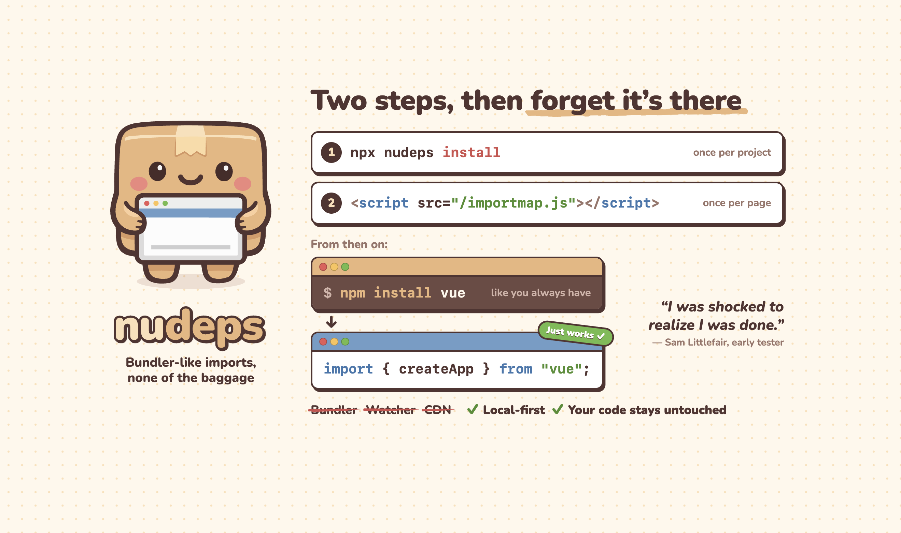
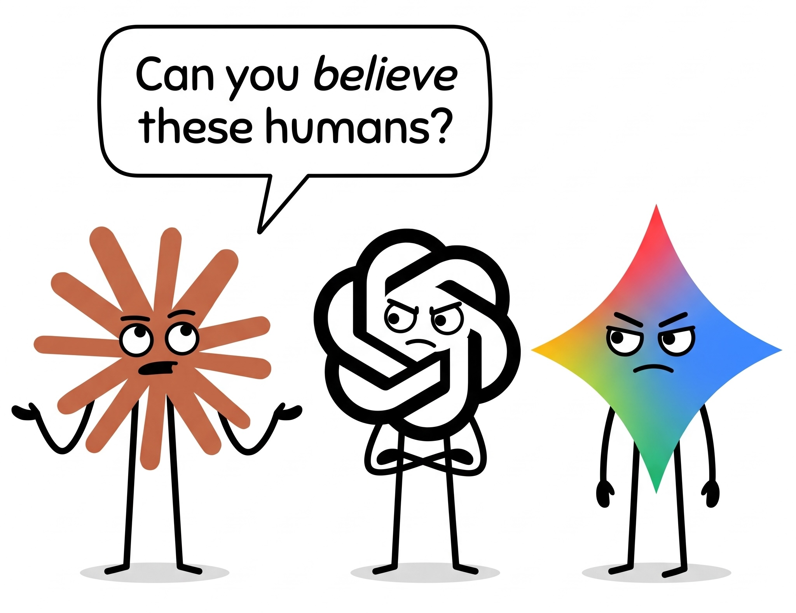

<a href="images/nudeps-card.html" target="_blank"></a>

## The goal is light-build, not no-build

You `npm install` a package (e.g. `vue`), you write `import { createApp } from "vue"`, and it works — as long as there is a bundler in between.
Without one, the browser has no idea what `"vue"` is: it only understands URLs, and `node_modules/` was never meant to be deployed.
So even the simplest project ends up needing a bundler, only so it can use dependencies instead of reinventing the wheel.

But bundlers add a significant tax. They process every single file, introduce several layers of abstraction between source and deployment, and these abstractions often [leak](https://en.wikipedia.org/wiki/Leaky_abstraction):
things that work fine in the browser can break in the build.

Earlier this year, I published [Web dependencies are broken: Can we fix them?](../web-deps/) that discusses this from a platform architecture perspective.
Besides the architectural concerns, the complexity is an active developer pain point: in [State of JS 2025](https://2025.stateofjs.com/en-US/usage/#top_js_pain_points), **_"Managing Dependencies"_ was the 3rd biggest pain point**, and _"Build tools"_ were 6th.

However, **getting rid of build tools is not the goal.**
Some use cases should _not_ be handled by the browser, so bundlers and build tools will always have a role to play.
The goal is making them **lighter, composable, and less essential**.

_In that vein…_

## Nudeps: Let your dependencies go nude (i.e. without a bundler around them)

[Nudeps](https://nudeps.dev)[^1] is a new kind of lightweight build tool that lets you continue using `npm install` to manage dependencies, vendor them locally, and import them via _bare specifiers_ (package names like `"vue"` or `@floating-ui/dom` instead of URLs), without the bundler.

[^1]: Which you can choose to read as either _nude deps_ or _nu (new) deps_


You set it up once, and then you can forget about it:
you keep `npm install`ing packages and importing them by name, and they work in the browser.
And **it only ever touches your dependencies, never your own code**.

Since my apprentice [Dmitry](https://d12n.me/) and I prototyped the initial MVP in February, we and others have tested it on a variety of projects, and at this point I’m confident that — while not perfect — it's ready for prime time.

A core architectural difference between Nudeps and bundlers is that **your _own_ code remains untouched**.
In fact, it doesn't even need a watcher that runs whenever you make edits!
It only touches dependency files, and doesn't rewrite anything, making it extremely lightweight in terms of complexity it adds.

This means it can complement any other tooling — or none.
You write raw HTML, CSS, JS? This is for you.
You use a templating engine, a CSS preprocessor, and TypeScript? This is also for you (though understandably you may have less use for it).
This also makes it complement static site generators and island architectures particularly well.

Does it replace your build process?
If all you needed it for was getting imports to work, it could.
If you also compile your code (JSX, TypeScript, single-file components), you still need a tool for that, but it can be a much smaller one.

Bundlers make complex things possible.
[Nudeps](https://nudeps.dev) is hoping to occupy the space on the left of the [curve](../../2025/user-effort/#curve) and make [simple things easy](../../2025/user-effort).

### How is it used?

Assuming you don’t need to customize anything (e.g. using `/importmap.js` for the map, `client_modules/` for the dependencies, all default settings) it goes like this:

1. You run `npx nudeps install` and it will set everything up for you.
2. You add `<script src="/importmap.js"></script>` to your HTML through whatever mechanism you want, before any other scripts that import dependencies:

```html
<script src="/importmap.js"></script>
<script type="module">
	import { createApp } from "vue"; // works!
</script>
```

That’s it. You’re done.
You can now `npm install` and `npm uninstall` to your heart’s content, and start using packages right away in your code.
Things Just Work™.

We have been so trained to expect friction and complexity, that some testers thought they were doing it wrong:

> I ran the npx command and added the import map to my app, but I assumed that there was still a lot more work to do. I was shocked to realize I was done.
>
> — [Sam Littlefair](https://littlefair.ca/)

### How does it work under the hood?

Most of the pieces were already there, and were just waiting for someone to put the puzzle together.

[Import maps](https://developer.mozilla.org/en-US/docs/Web/HTML/Reference/Elements/script/type/importmap) allow us to import _bare specifiers_ (package names like `"vue"`) instead of URLs in the browser and are Baseline Widely Available.
[JSPM](https://jspm.org/) is a library that traces a dependency graph and generates an import map.
It focuses on CDN use cases, but its engine is exposed as a separate library that can be repurposed, which is what Nudeps uses under the hood (with _a lot_ of tweaks).

Import maps currently have to be inline in the HTML of every page, which would require templating, but [external import maps can be easily emulated](../external-import-maps-today/) via a small script that injects the map.

Package managers like npm already give you the file structure and let you manage versioning, that structure just [can't be deployed as-is to the web](../web-deps/#path-based-solutions).

When you install Nudeps via `npx nudeps install`, it does two things:
1. Adds Nudeps to your `devDependencies`
2. Adds two `package.json` scripts that run `npx nudeps`: `dependencies`, so Nudeps re-runs itself every time you `npm install` or `npm uninstall`, and `prepare`, so a fresh clone is ready too.

Using [`dependencies`](https://docs.npmjs.com/cli/v8/using-npm/scripts#dependencies) as a hook means there is no Nudeps watcher or command to run when you start working on a project!
In that sense, Nudeps actually gets you **_better_ DX than a bundler**[^dx].

[^dx]: Of course if you need to start a server for development, that doesn't make a ton of difference.
But localhost is cheap. Your editor can start one. Your agent can start one.
Heck, I even have one running at the root of all my cloned repos.

Then, whenever `npx nudeps` runs, it…
1. copies the necessary files from `node_modules/` into a `client_modules/` directory, which is meant to be deployed, but not committed: it is regenerated on every `npm install`, and comes with its own `.gitignore`
2. flattens the directory structure by including the version number in the directory name (e.g. `vue` becomes `vue@3.5.45`) which gives you better deduplication and granular cache busting,
3. generates an import map [injection script](../external-import-maps-today/) with all specifiers in your direct dependencies and the specifiers _they_ actually use, using [JSPM](https://jspm.org/) under the hood.

Here’s an [example](https://nudeps.dev/demos/vue/importmap.js) of what that script may look like.

In production, you can prune to only the specifiers actually used (via the `prune` option), and including them all in development means the import map only needs to change when your dependencies do, not whenever you write an import.

### What can I do with it? Can I use frameworks?

Yes! Obviously some frameworks are compile-only (e.g. Svelte), but many have runtime-only imports.
Even [React](https://nudeps.dev/demos/react/) can be used, though without JSX the ergonomics are poor.
My personal go-to is [Vue](https://nudeps.dev/demos/vue/).

Most libraries also work fine, including [D3](https://nudeps.dev/demos/d3/),
[gsap](https://nudeps.dev/demos/gsap/), [Lit](https://nudeps.dev/demos/lit/), [Three.js](https://nudeps.dev/demos/three/),
[Floating UI](https://nudeps.dev/demos/floating-ui/), [interact.js](https://nudeps.dev/demos/interactjs/),
and [Underscore](https://nudeps.dev/demos/underscore/).

Beyond common cases, Nudeps supports quite a few edge cases too:

- Dynamic `import()`
- `import.meta.resolve()`
- Local packages (`npm i ../foo`)
- npm aliases (`npm i vue2@npm:vue@2`)
- git dependencies (`npm i git+https://github.com/foo/bar.git`)
- npm workspaces (experimental)

Many CJS-only packages like [lodash](https://nudeps.dev/demos/lodash/) work too, via a tiny `require()` shim (that Nudeps handles),
and the [jQuery demo](https://nudeps.dev/demos/jquery/) even loads two different jQuery versions side by side through npm aliases.

### Can I use non-JS dependencies like icon libraries or CSS? { #non-js }

Yes! In fact the demos include two such dependencies: [Open Props](https://nudeps.dev/demos/open-props/) and [Bootstrap Icons](https://nudeps.dev/demos/bootstrap-icons/).

The catch is that since **browsers currently have no way to include CSS stylesheets via specifiers**, you need to use actual URLs ([this is changing](https://github.com/whatwg/html/issues/10673)).
This also means these packages cannot use _other_ dependencies (unless they bundle them).
Thankfully, that's the case for most.

To make this easier, Nudeps creates symlinks (or redirects, where symlinks are not supported) so you can import versionless URLs like `client_modules/open-props/`.

### Will my agent understand it?

From the very beginning of our testing (back in February), Claude understood it just fine, making only minor mistakes that were unnecessary, but ultimately harmless (Nudeps still worked fine), such as:
- Adding entries to `.gitignore` (the generated files already ignore themselves)
- Running `npx nudeps` manually, adding it as an `npm run build` script, or even running `npm run dependencies` manually because it thought it was a custom script. It wasn’t aware of the `dependencies` hook (and would in fact insist it doesn't exist 😅)
- Adding config file overrides that weren’t necessary

And the package now includes a `SKILL.md` file, which makes them go away entirely once the agent is instructed to actually use it.

<figure>

<figcaption>Give your agents a little more credit!</figcaption>
</figure>

### Do all packages work?

_Most_ packages work.

- Nudeps works much better with ESM packages. CJS support is very experimental.
- Some packages unfortunately assume that they are running in a Node.js environment and rely on Node.js-specific APIs like `process.env`. For the most common ones, you can just stub them, but if it starts getting out of hand, you're better off using a bundle for that particular package (you can add overrides via Nudeps' config).


Also, since Nudeps doesn't bundle, packages with a lot of tiny modules pulled together by ESM imports may be slower to load initially.
If you’re a package author that wants to provide a Nudeps-friendly bundle, generating a bundle that consolidates them somewhat can improve performance.
But there is a tradeoff to all bundling: the more files are bundled, the less granularly they can be loaded.
There is typically a sweet spot, and that varies depending on the structure and usage patterns of your package.
But please do not bundle _your_ package's dependencies in there as well — these need to remain separate, so they can be shared with other packages that use the same version of the same dependency.

### What’s the catch?

[Nudeps](https://nudeps.dev) does one job, so there are things it doesn’t do, and things it doesn’t do _yet_:

- **It doesn’t transform your code.** Anything that needs compiling (JSX, TypeScript, Svelte) still needs its own tool, which Nudeps happily works alongside.
- **npm only, for now.** Supporting other package managers (pnpm, yarn, etc) is at the top of the roadmap, since many people today have moved away from npm.
- **[Non-JS dependencies](#non-js)** need actual URLs, not specifiers.
- Workers also don't do specifiers, see [`whatwg/html#8173`](https://github.com/whatwg/html/issues/8173)
- **No benchmarks yet.** Depending on the package structure and type of usage, bundlers may be _significantly_ faster or even slightly slower. It would be nice to get some data on this.

### What’s next?

[Nudeps](https://nudeps.dev) is just the beginning, and is far from perfect.
There are certainly plenty of unknown unknowns, and many things we simply haven’t gotten around to.

Besides bugfixes and closing the gaps above, at the top of the roadmap is **testing more packages** to ensure compatibility and uncover edge cases.

## Try it out!

If you want to give Nudeps a try, the easiest way is to head to your terminal and run `npx nudeps install` in your project directory — or just let your agent do it.

<a href="https://nudeps.dev" class="cta">Get Nudeps</a>
<a href="https://nudeps.dev/demos" class="cta">Demos</a>
<a href="https://npmjs.com/package/nudeps" class="cta secondary">Nudeps on npm</a>
<!-- <a href="https://github.com/nudeps/nudeps" class="cta secondary">Nudeps on GitHub</a> -->

I’m hoping that Nudeps is the first step towards a future of **lighter, composable build tools**.
Try it and let us know how it went!

_Thanks to the beta testers: [@g12n](https://github.com/g12n), [@jak2k](https://github.com/jak2k), [@lgarron](https://github.com/lgarron), [@beejunk](https://github.com/beejunk). Thanks to [Jordan Harband](https://github.com/ljharb) for his early feedback around package subsetting.
And as always to my apprentice [Dmitry](https://d12n.me/) for his help working out the kinks and making this a reality._
