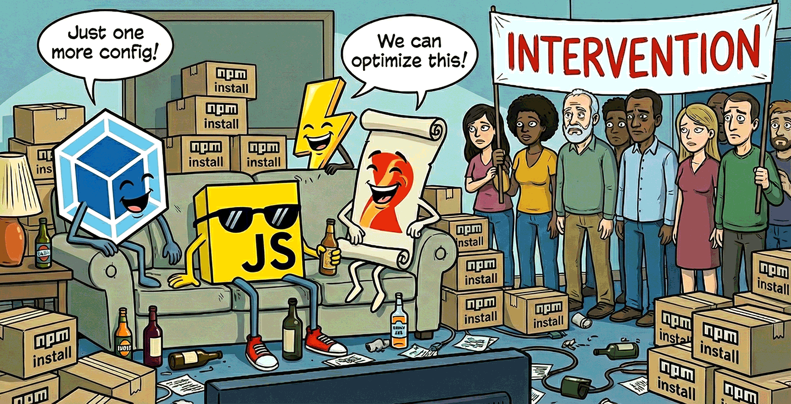
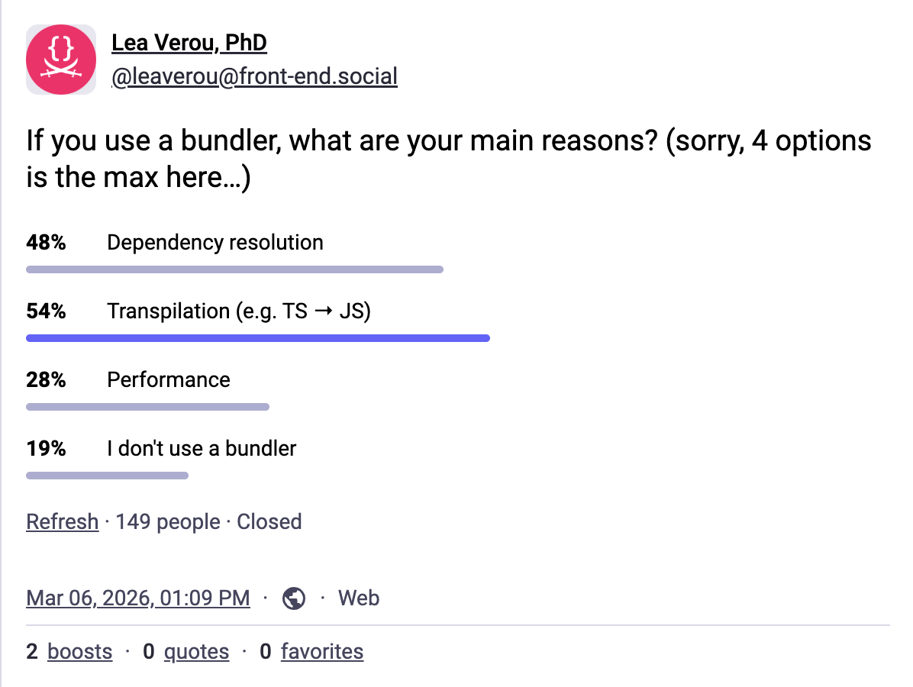
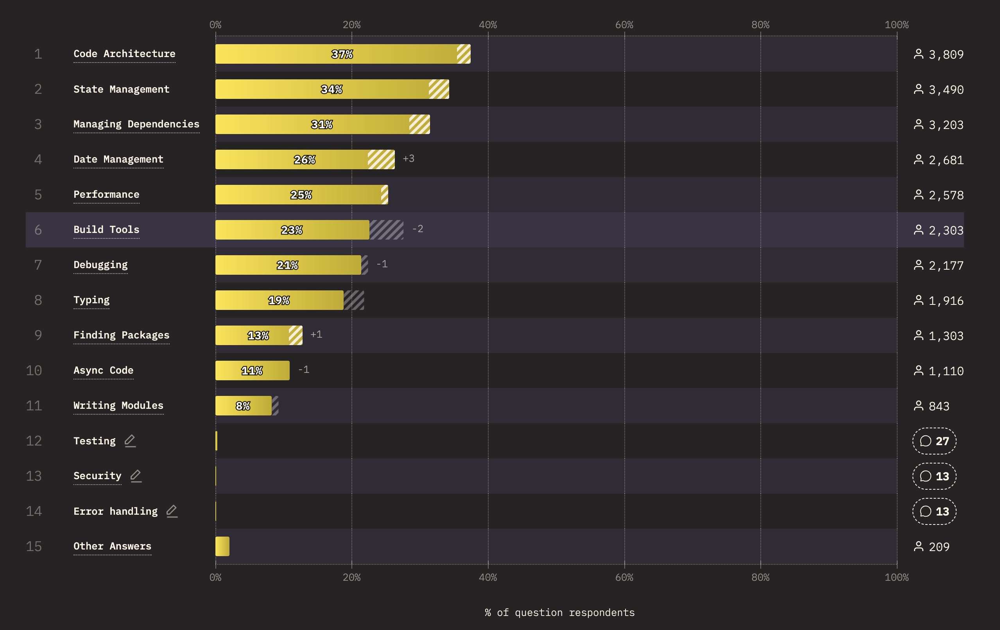
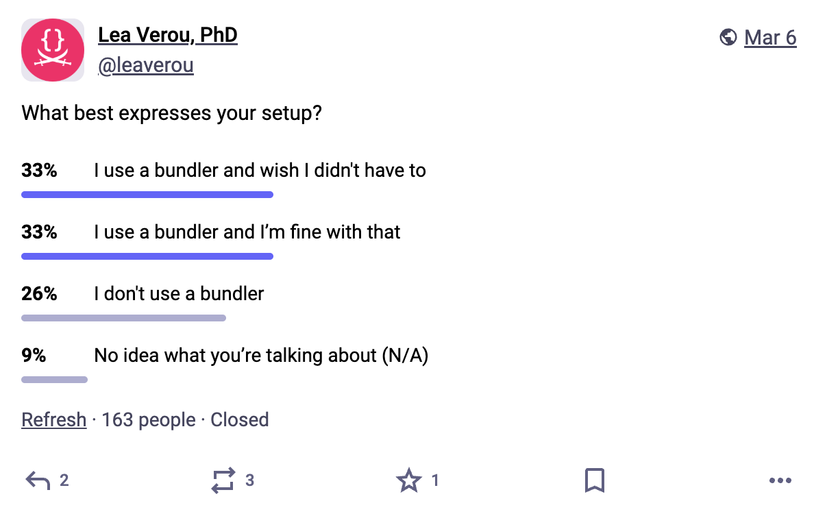
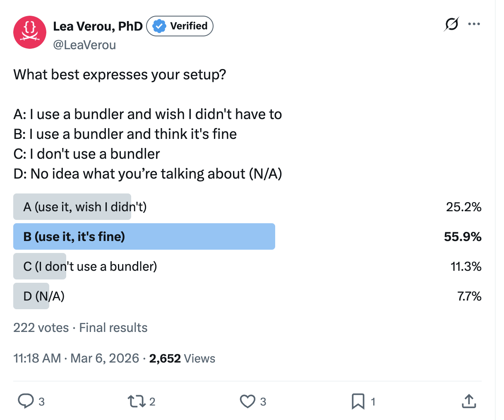
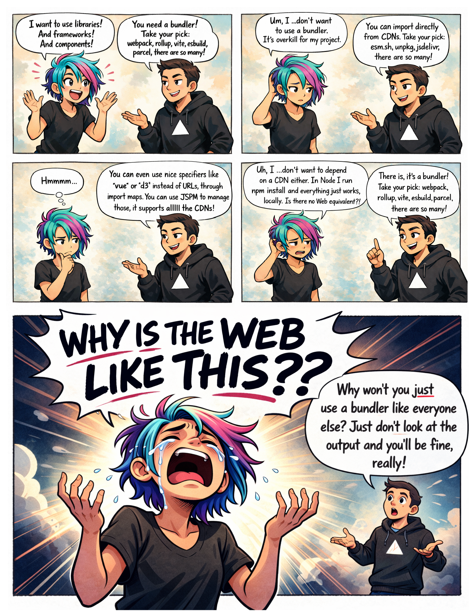

<figure class="no-padding">

<figcaption>
No, this is not another rant about npm’s security issues.
</figcaption>
</figure>

**Abstraction** is the cornerstone of modern software engineering.
Reusing logic and building higher-level solutions from lower-level building blocks is what makes all the technological wonders around us possible.
Imagine if every time anyone wrote a calculator they also had to reinvent floating-point arithmetic and string encoding!

<aside class="pullquote">

> In healthy ecosystems dependencies are normal, cheap, and first-class.
> "Dependency-free" is not a badge of honor.

</aside>

And yet, **the web platform has outsourced this fundamental functionality to third-party tooling**.
As a result, code reuse has become a balancing of tradeoffs that should not have existed in the first place.

In NodeJS, you just `npm install` and reference specifiers straight away in your code.
Same in Python, with `pip install`.
Same in Rust with `cargo add`.
In healthy ecosystems **dependencies are normal, cheap, and first-class**.
You just install them using the one standard way, use them, and move on.
You don't have to ponder which third-party tool to use, or — worse — whether to use dependencies at all.
**"Dependency-free" is not a badge of honor.**

Instead, dependency management in the web platform consists of **bits and bobs of scattered primitives, with no coherent end-to-end solution**.
Naturally, bundlers such as [Webpack](https://webpack.js.org/), [rollup](https://rollupjs.org/), and [esbuild](https://esbuild.github.io/) have picked up the slack, with [browserify](https://browserify.org/) being the one that started it all, in 2012.
<!-- more -->

## Dependencies are too essential to be outsourced

On a very high-level, there are four things a bundler does for you:
1. **Performance optimizations**: e.g., tree-shaking, prerendering, code splitting, minification, etc
2. **Transpilation / Templating**, parsing one syntax and converting it to another. This includes templating, JSX, CSS preprocessing, TypeScript compilation, etc
3. **Dependency management**. Making it possible to use libraries installed via package managers like npm or yarn
4. **Debugging improvements**: Hot reloading, source maps, etc.

One of these is not like the others.
Can you tell which one?

Performance, debugging improvements, and transpilation are generally _advanced_ concerns.
They are QoL improvements, but you can get quite far without them.^[The only exception is perhaps HTML includes, which are already [being prototyped in Chrome 🎉](https://groups.google.com/a/chromium.org/g/blink-dev/c/rjBSVWAGoHo/m/FhEGrTIkAwAJ).]

But dependencies?
**Dependencies are _essential_!**
You don't want to be writing your own drag and drop library, UI components, icons, charting library, and so on.
In the vast majority of websites or libraries, the need for dependencies comes up in the first few lines of code.

Do you see the problem now?
Requiring **complex tools for complex needs** is totally fine!
But when you need **complex tools for basic needs**, that’s a smell that something is seriously broken in the ecosystem.
Dependency management is such a basic and ubiquitous need, it should be a part of the platform, decoupled from bundling.

Bundling is not *technically* a necessary step of dependency management.
Importing files through URLs is natively supported in every browser, via ESM imports.
HTTP/2 makes importing multiple small files far more reasonable than it used to be — at least from a connection overhead perspective.
Sure, a bundler will _always_ win on first load, as it knows far more about your app than the browser ever could.
But that is precisely the kind of optimization you should be able to layer on later, not the price of admission.
**You can totally get by without bundlers in a project that doesn't use any libraries.**

**But the moment you add that first dependency, everything changes.**
You are suddenly faced with a huge [usability cliff](https://lea.verou.me/blog/2025/user-effort/#cliffs):
which bundler to use, how to configure it, how to deploy with it, a mountain of decisions standing between you and your goal of using that one drag and drop library.
A meta-framework does take the thought out of this, which is how we end up with websites using Next.js for a simple landing page.

<figure>
<object data="images/curve-cliff.svg" type="image/svg+xml" width="100%" height="auto">
</object>
<figcaption>

Dependency management is one of the web platform's [usability cliffs](https://lea.verou.me/blog/2025/user-effort/#cliffs): a small increase in use case complexity results in a large increase in system complexity.
</figcaption>
</figure>

## How did we get here?

Many of us old farts often reminisce about the good old days: the simplicity of editing a file and seeing the result, no build step, no watcher, no configuration.
But that carefully leaves out the numerous things that downright _sucked_, and dependency management was chief among them.

Remember when every dependency was basically a peer dependency, and you had to manually add `<script>` elements, not just for every dependency, but for _their_ dependencies too?
And get the order right?
And good luck if two of them needed different versions of the same library — who remembers `jQuery.noConflict()`?
I won't even get into how versioning was done, to protect your sanity.
You young'uns have _no_ idea how good you have it.

<figure class="width-m float">

[](https://front-end.social/@leaverou/116183570463039830)

<figcaption>
Despite the name "bundler" hinting towards performance, dependency management outranks it as a motivating use case.
Mastodon-only, as X/Twitter does not support multiple choice polls.
</figcaption>
</figure>

**Bundlers gave us the DX of the NodeJS ecosystem**: `npm install` and then you just import.
The performance optimizations, debugging affordances, and transpilation were a nice cherry on top, but they are not what drove adoption.

Dependency management is also the hairiest of the four, because it has tentacles over _everything_.
We had been transpiling and optimizing code with separate build scripts since the beginning of time, and that was never a problem:
TS becomes JS and is then handled like regular JS.
SCSS becomes CSS and is then handled like regular CSS.
Nothing else in the codebase needs to know.
But _every_ part of the codebase needs to know how the repo manages dependencies.
**That is what drove monolithic bundlers to ubiquity**: not performance, not transpilation, but the one basic need the platform never covered.

## Don’t look at usage, look at sentiment { #sentiment }

**Asking developers whether they use a bundler is the wrong question.**
Of course they do. You can't survive without it!
Per [State of JS 2024](https://2024.stateofjs.com/en-US/libraries/build_tools/), Webpack alone has been used by 9 in 10 developers, with close to 100% awareness.
Even CodePen had to add bundler support, because even small testcases and experiments are a pain without one.

Instead, try asking them how they _feel_.
Despite the ubiquity of bundlers, "managing dependencies" was still No 3 in the [State of JS pain points](https://2025.stateofjs.com/en-US/usage/#top_js_pain_points), right after "Code architecture" and "State management"!

<figure>


<figcaption>
Relevant: Dependency management is the 3rd JS pain point, and build tool issues 6th, above debugging even!
</figcaption>
</figure>

And sorting the State of JS build tool data by sentiment paints a very different picture than usage does, with satisfaction, interest, and positivity dropping year after year.
Even those who never question the status quo can feel it in their gut that this is not okay.

So I asked point blank: do you use a bundler, and do you _wish_ you didn't?

<figure class="multiple">
<style>
@scope {
    a {
        display: contents;
    }
    img {
        max-height: 17.7em;
    }
}
</style>

[](https://front-end.social/@leaverou/116183104223337632)
[](https://x.com/LeaVerou/status/2029954764482486586)
<figcaption>

Social media polls, run in March 2026.
Yes, most developers use a bundler (88% on Twitter, 72% on Mastodon),
but a pretty high percentage wishes they didn’t (**a third** of bundler users on X/Twitter and **half** on Mastodon).
</figcaption>
</figure>

A third to half is a pretty high amount of dissatisfaction!
And when I had asked back in January, I was surprised to see how many had skipped bundlers altogether: [17.6% on Twitter/X](https://x.com/LeaVerou/status/2008341499461743048) and [40% (!) on Mastodon](https://front-end.social/@leaverou/115840120189230465).
Obviously, all of these suffer from [selection bias](https://en.wikipedia.org/wiki/Selection_bias), due to the [snowball sampling](https://en.wikipedia.org/wiki/Snowball_sampling) nature of social media, but the pattern is consistent.
I’m very curious how these folks manage the problems discussed below.

Anecdotally, from my conversations with developers, it seems the rest have simply resigned to the complexity in the same way one resigns to paying taxes, and just accept the status quo as the price to pay to deploy a website.
Like [boiling frogs](https://en.wikipedia.org/wiki/Boiling_frog), **JS developers have resigned themselves to immense levels of complexity and gruntwork** as simply *how things are*.
The rise of AI introduced swaths of less technical folks to web development and their overwhelm and confusion is forcing us to take a long hard look at the current shape of the ecosystem — and it's not pretty.

## Dependencies without bundlers, today?

<figure class="width-m float">


<figcaption>
The experience of going no-build today is fraught with hazards.
</figcaption>

</figure>

It *is* technically possible to use dependencies without bundlers, today.
There are a few different approaches, and — I will not sugarcoat it — **they all suck**.

Fundamentally, there are two ways to reference a dependency: by **URL** or by **specifier**.
URLs can be local (a path in your project) or remote (a CDN).
Specifiers need something to map them to URLs, which today means import maps.
There is currently no good answer for any of these, only fragile workarounds held together by duct tape.

Using a dependency should not need any additional song and dance besides "install this package" + "now import it here".
That’s it.
That’s the [minimum necessary to declare intent](https://lea.verou.me/blog/2025/user-effort/#signal-to-noise).
And that’s *precisely* how it works in NodeJS and other JS runtimes.
Anything beyond that is reducing [signal-to-noise ratio](https://lea.verou.me/blog/2025/user-effort/#signal-to-noise), especially if it needs to be done separately for every project or worse, for every dependency.

You may need to have something to bite hard on while reading the next few sections.
It’s going to be _bad_.

### Path-based solutions

Typically, package managers like `npm` take care of deduplicating compatible package versions and may use a directory like `node_modules` to install packages.
Some developers notice this and try rawdogging `node_modules/` imports:

```js
import { createApp } from "../node_modules/vue/dist/vue.esm-browser.js";
```

Eek. It works (in some cases), but deploying your entire `node_modules` directory is both **wasteful**, and a **security risk**. In fact, most serverless hosts (e.g. [Netlify](https://www.netlify.com/) or [Vercel](https://vercel.com/)) automatically remove it from the publicly deployed files after the build is finished, which means you need additional code to reinstate it or rewrite these imports.

Others have tried isolating the packages they actually need and copying them into a separate directory:

```json
{
	"scripts": {
		"lib": "cp node_modules/vue/dist/vue.esm-browser.js common/lib/vue.js",
		"build": "npm run lib"
	}
}
```

It’s a little better than the former, but now you need to keep track of what packages each package imports and copy them too. Yikes!

But zooming out, both of these approaches are severely problematic, for two bigger reasons.

**First, they break transitive dependencies.**
This may work fine when you're vendoring packages with no dependencies of their own, but the moment you use a package that uses another package, it all collapses like the tower of cards it is.
Even if you were willing to hunt down which of your packages use dependencies and vendor those too, how would the packages even _reference_ them?
They have no idea what your directory structure looks like.
Unless, of course, you're willing to rewrite the files you're copying — but now you're building your own bundler. Please don't.
And even if a package uses no dependencies today, that may change tomorrow, so instead of building whatever it is you're building, you're now monitoring your dependencies' dependencies.

As someone who regularly releases open source packages ([some with billions of npm installs](https://npm-stat.com/charts.html?package=prismjs&from=2012-01-01)), I find this incredibly frustrating.
**I want to write packages that can be consumed by people using whatever they want to manage their dependencies**, but the only way to do that today is to basically not use any dependencies.
I cannot even modularize *my own* packages without running into this!
_This doesn't scale._
The creator of htmx [reached the same conclusion](https://htmx.org/essays/vendoring/#:~:text=On%20the%20other,on%20and%20on.), and committed to _not_ using dependencies so that their users can vendor htmx.
This is an _awful_ compromise that no library author should be forced into.

### Specifiers are essential abstraction { #specifiers }

**Second, any path-based solution breaks encapsulation.**
There is a reason why we reference packages using specifiers like `vue` or `lit` instead of URLs to the actual files.

**Specifiers are an abstraction over URLs**, but an _essential_ one for dependency management.
We don’t use specifiers instead of URLs because they look a little prettier.
We use them because they decouple a dependency from:
- the exact location of the package
- the exact file path within the package (which often changes between versions)
- the exact version, for the source referencing (different packages may import different versions of the same dependency using the same specifier)
- the import conditions (e.g. browser, node, types, etc)

Worse, without specifiers, transitive dependencies have nothing reasonable to reference.

**Specifiers should be non-negotiable.**
You should never have to track what the specifiers of your dependencies map to and update your code when they change.
Seriously, if you find yourself doing that, take a long hard look in the mirror and ask yourself where things went wrong.
Any dependency management system that forces you to write out paths manually should be a non-starter, period.
The cost-benefit is just not there.

### Importing from public CDNs

Another common path is importing from CDNs like [Unpkg](https://unpkg.com/) and [JSDelivr](https://www.jsdelivr.com/).
For Vue, it may look like this:

```js
import { createApp } from "https://unpkg.com/vue@3";
```

It’s quick and easy.
Nothing to install or configure!
Some CDNs, like [esm.sh](https://esm.sh/), even rewrite specifiers on the fly, so transitive dependencies Just Work™, making this the only URL-based approach that actually scales.
Great, right?

_No._ Not great.

**It is always a bad idea to introduce a dependency on a whole other domain you do not control**, and an even worse one when linking to executable code.

First, there is the obvious security risk.
Unless you link to a specific version, down to the patch number and/or use [SRI](https://developer.mozilla.org/en-US/docs/Web/Security/Defenses/Subresource_Integrity), the resource could turn malicious overnight under your nose if the package is compromised.
And even if you link to a specific version, there is always the risk that the CDN itself could get compromised.
Who remembers [polyfill.io](https://blog.qualys.com/vulnerabilities-threat-research/2024/06/28/polyfill-io-supply-chain-attack)?

But supply-chain attacks aside, any third-party domain is an unnecessary **additional point of failure**.
I still remember scrambling to change [JSDelivr](https://www.jsdelivr.com/) URLs to [Unpkg](https://unpkg.com/) during an outage right before one of my talks, or having to hunt down all my repos that used [RawGit](https://rawgit.com/) URLs when it sunset, including many libraries.

The DX is also suboptimal.
**You lose the immediacy and resilience of local paths.**
Without additional tooling ([Requestly](https://requestly.com/), `hosts` file edits, etc.), you now need to wait for CDN roundtrips even during local development.
Wanted to code on a flight?
Good luck.
Needed to show a live demo during a talk, over clogged conference wifi?
Maybe sacrifice a goat to the gods. 🐐

There is a subtler problem too.
Specifiers don't just abstract over locations, they also **enforce consistency across the codebase**: `import "marked"` means the same thing in every file of your project.
With URLs, nothing stops `foo.js` from importing `marked@18` while `bar.js` imports `marked@17`, and you end up shipping both, possibly even from different CDNs.
Multiple versions of the same dependency _can_ coexist, but that should be a deliberate choice, not accidental drift.
And with AI defaulting to local edits, cross-codebase consistency is now more important than ever.

<!-- And while they maintain encapsulation slightly better than raw file imports, as they let you reference a package by its name for its default export,
additional specifiers (e.g. `packagename/fn`) typically still require importing by file path. -->

_“But with public CDNs, I benefit from the resource having already been cached by another website the user visited!”_<br>
Oh my sweet summer child.
I hate to be the one to break it to you, but no, you don’t, and that has been the case [since about 2020](https://addyosmani.com/blog/double-keyed-caching/).
**_Double keyed caching_ obliterated this advantage**.

<aside class="info">
<h4>What is double keyed caching?</h4>

In case you were not aware, yes, your browser will **redownload every single resource** anew for every single website (origin) that requests it.
Yes, even if it’s exactly the same.
This changed to prevent [cross-site leaks](https://developer.mozilla.org/en-US/docs/Web/Security/Attacks/XS-Leaks): malicious websites could exfiltrate information about your past network activity by measuring how long a resource took to download, and thus infer whether it was cached.

Those who have looked into this problem claim that there is no other way to prevent these timing attacks other than to actually redownload the resource.
No way for the browser to even fake a download by simply delaying the response.
Even requiring resources to opt-in (e.g. via CORS) was ruled out, the concern being that websites could then use it as a third-party tracking mechanism.

I personally have trouble accepting that such wasteful bandwidth usage was the best balance of tradeoffs for [all Web users](https://www.w3.org/TR/ethical-web-principles/#allpeople), including those in emerging economies and different locales[^finding].
It's not that I don’t see the risks — it’s that I am acutely aware of the cost,
a cost that is disproportionately borne by those not in the [Wealthy Western Web](https://www.smashingmagazine.com/2017/03/world-wide-web-not-wealthy-western-web-part-1/).

**How likely is it that a Web user in Zimbabwe, where [1 GB of bandwidth costs 17% of the median monthly income](https://bestbroadbanddeals.co.uk/mobiles/worldwide-data-pricing/), would choose to download React or nine weights of [Roboto](https://fonts.google.com/specimen/Roboto) thousands of times to avoid seeing personalized ads?**
And how patronizing is it for people in California to be making this decision for them?

[^finding]: In fact, when I was in the TAG, Sangwhan Moon and I [drafted a Finding](https://w3ctag.github.io/caching-bundling-sustainability/) on the topic, but the TAG never reached consensus on it.

</aside>

<!-- ### "Browser" bundles considered harmful

As a fig leaf, libraries will often provide a "browser" bundle that consumers can import instead of their normal `dist`, which does not use specifiers.
This combines all _their_ dependencies into a single dependency-free file that you can import from a browser.
This means they can use whatever dependencies they want, and you can still import that bundle using regular ESM imports in a browser, sans bundler.
_Great, right?_

No. Not great.

Unless no other packages share the same dependencies, this is wasteful AF.
It means their dependencies cannot be shared with any other dependency in your tree, even if it’s a compatible version of the same package.
**You’re not avoiding bundling, you’re outsourcing it**, and multiplying the size of your JS code in the process.

And if the library author has _not_ done that, you’re stuck with little to do, besides a CDN that rewrites specifiers on the fly like [esm.sh](https://esm.sh/), with all CDN downsides described above. -->

## Import maps to the rescue?

Browsers _can_ import specifiers, as long as the mapping to a URL is explicitly provided through an [import map](https://developer.mozilla.org/en-US/docs/Web/HTML/Reference/Elements/script/type/importmap).
Import maps look like this:

```html
<script type="importmap">
{
	"imports": {
		"vue": "./node_modules/vue/dist/vue.runtime.esm-bundler.js",
		"lodash": "./node_modules/lodash-es/lodash.js",
	}
}
</script>
```

Did you notice something?
Yes, this is an HTML block.
No, I cannot link to an import map that lives in a separate file.
Instead, I have to include the darn thing in. Every. Single. Page.

“💡 *Oh I know, I’ll inject it via DOM methods!*” I hear you say.
Yes, my sweet summer child, that actually works — as long as it's done from a classic (non-module) script that runs before any module is fetched.
It's clunky, but it's what lets us [emulate external import maps today](../external-import-maps-today/), and it's what [JSPM 4.0](https://jspm.org/jspm-4.0-release) does.
So at least we can dodge the HTML templating tool. 🎉

“💡 *And I’ll keep it short by routing everything through a CDN or the same local folder!*”
No, my sweet summer child.
Go to sleep and dream of [globs](https://github.com/whatwg/html/issues/11919) and [URLPatterns](https://developer.mozilla.org/en-US/docs/Web/API/URLPattern).
Then wake up and get to work, because you actually need to specify. Every. Single. Mapping.
Yes, transitive dependencies too.

<figure>


<figcaption>

**You wanted to use dependencies?
You will pay with your blood, sweat, and tears.**
Or, well, another build tool.
</figcaption>
</figure>

**So now I need a build tool to manage the import map**, like [JSPM](https://jspm.org/).

There are three invariants that import maps violate:
1. **Locality**: Dependency declarations live in one global map owned by the final consumer. A library cannot even ship a fallback mapping, so it has no way to guarantee it works outside the consumer's setup.
2. **Composability**: Import maps do not compose across dependencies and require global coordination
3. **Scalability**: Mapping every transitive dependency is not viable without tooling

Plus, you still have all of the issues discussed above, because you still need URLs to link to.
Notably, JSPM's primary flow is linking to `node_modules/` on localhost and a CDN (they have their own too, that is optimized for this) in production.
If you don’t want to use CDNs in production, you’re SOL.

To sum up, **import maps are not the solution, but they are an essential part of it**.
They give us specifiers in the browser, which is huge, but on their own they don't eliminate the need for tooling — they just make _lighter_ tooling possible.
And a lighter build tool is still an improvement!

<figure>

Comic strip showing a conversation between two characters about the complexity of web development.
Panel 1:
A (excitedly): I want to use libraries! And frameworks! And components!
B: You need a bundler! Take your pick: webpack, rollup, vite, esbuild, parcel, there are so many!
Panel 2:
A (troubled): Um, I …don't want to use a bundler. It’s overkill for my project.
B: Well… you can import directly from CDNs. Take your pick: jspm.io, esm.sh, unpkg, jsdelivr, there are so many!
Panel 3:
A (troubled and pensive): Hmmmm… 🤔
B (oblivious): …you can even use nice specifiers like `vue` or `d3` instead of URLs, through import maps. You can use JSPM to manage those, it supports alll the CDNs!
Panel 4:
A (visibly uncomfortable and increasingly outraged): Uh, I …don’t want to depend on a CDN. Can’t I have dependencies that are _both_ local _and_ easy to manage? In Node I can just run `npm install` and everything just works without all this complexity. What’s the Web equivalent?
B: It’s a bundler! Take your pick: webpack, rollup, vite, esbuild, parcel, there are so many!
Panel 5 (dramatic climax, panel much wider than the previous panels (aspect ratio ogf about 2.5:1)):
A (head tilted back, mouth wide open, tears streaming, wails loudly): WHY IS THE WEB LIKE THIS??
B (still visible on the far right, small and passive, in the background, looking baffled): Why won't you just use a bundler like everyone else? Just don't look at the output and you'll be fine, really!


<figcaption>
This has been me more times than I can count.
</figcaption>
</figure>

## Are bundlers the lesser evil?

Given the current state of the ecosystem, not using bundlers in any nontrivial application does seem like an exercise in masochism.
And yet, [as we saw](#sentiment), a surprising share of developers do exactly that, and a much larger share wishes they could.
This is not a reasonable way to manage dependencies.
**This is not a healthy ecosystem.**

Oftentimes when discussing these issues, I get the question "but other languages are completely compiled, why is it a problem here?".
**Yes, but their compiler is official and always there.**
You literally can't use the language without it.
You don't get a broken experience, you get _no_ experience.

**The problem is not compilation, it’s fragmentation.**
It's the newbie trying to use a drag and drop library, only to get mysterious errors about specifiers that failed to resolve.
It's having to add mountains of config and complexity to use a utility function.
It's having no clear path to write a package that uses another package, even if both are yours.

<blockquote class="pullquote" style="max-width: 10em">The problem is not compilation, it’s fragmentation.</blockquote>

**Abstraction itself is not something to outsource** to third-party tools.
This is the programming equivalent of privatizing fundamental infrastructure — roads, law enforcement, healthcare — systems that work precisely because everyone can rely on them being there.

This is also actively **harming web platform architecture**.
A general API design principle is to prioritize the needs of consumers over the needs of producers; the web platform even has its own version, the [priority of constituencies](https://www.w3.org/TR/design-principles/#priority-of-constituencies).
When it comes to bundlers, web developers are the consumers, so their needs should come first.
But bundler ubiquity has reversed the natural order: now web developers cater to bundlers.
Code that works perfectly fine in a browser has to be [rewritten to work in bundlers](https://github.com/color-js/elements/commit/e685c86297a580c52caae4bcc8f1e25ea3d830e3).
And because bundlers are so ubiquitous, we have ended up designing the platform around them, when it should be the opposite.
<!-- For example, because `import.meta.url` is unreliable when bundlers are used, components have no robust way to link to other resources (styles, images, icons, etc.) relative to themselves, unless these resources can be part of the module tree.
So now we are adding features to the web platform that break any reasonable assumption about what HTML, CSS, and JS are, like JS imports for CSS and HTML, which could have been a simple `fetch()` if web platform features could be relied on. -->

<!-- And because using dependencies is nontrivial, we are adding features to the standard library that could have been userland or even browser-provided dependencies. -->

To reiterate, **the problem isn’t that bundlers exist** — it’s that they are the only viable way to get first-class dependency management on the web.

**JS developers deserve better. The web platform deserves better.**

## Where do we go from here? { #future }

<blockquote class="pullquote">The web platform's specifier support feels like an arcade demo: you get to watch the first level, but there's no coin slot to play the actual game.</blockquote>

As a web standards person, my first thought when spotting such a lacking is "how can the web platform improve?".
And after four years in the [TAG](https://en.wikipedia.org/wiki/Technical_Architecture_Group), I cannot shake the holistic architectural perspective of ***"which part of the Web stack is best suited for this?"***
The following is my take.

### We need specifiers _everywhere_

It is clear that specifiers are an essential piece of the puzzle, for the reasons [mentioned earlier](#specifiers).
The web platform's specifier support feels like an arcade demo: you get to watch the first level, but there's no coin slot to play the actual game.
While the web platform provides import maps to map specifiers to URLs, they only work for JS dependencies.
But the Web is not just JS!
What about CSS frameworks, icons, fonts, etc.??
There is no way to use specifiers for any other type of resource.
You either rawdog URLs, or give up and use a bundler already.

Even for JS dependencies, specifiers don't yet work in workers, but that's a relatively simple fix, [whatwg/html#10858](https://github.com/whatwg/html/pull/10858) has just stalled due to lack of time.

Oh, and fun fact: they don’t even work in `<script type=module src="foo">`!
That `foo` will be interpreted as a local URL, even if you’ve defined a corresponding specifier.
Which brings me to my next point.

How could we retrofit specifiers into the web platform?
We can't just start accepting specifiers in places designed for URLs — `<link rel=stylesheet href="foo">` or `@import url('foo');` already have an established meaning: they are relative URLs to the file called `foo`.
**ESM avoided this by designing imports with specifier disambiuguation from the get go.**

The solutions are to either add one-off ESM-like specifier-first referencing syntax in every part of the platform that may want to import any resource from a dependency (CSS files, `<script src>`, CSS `@import`, CSS `url()`, SVG `<use>` etc etc),
or to design a new URL scheme (`specifier:`?) to reference them everywhere (which is what I [proposed](https://github.com/whatwg/html/issues/12163) a while ago).
An advantage of that is also that it **bridges the gap between specifiers and URLs**.
Rather than having two entirely separate primitives for linking to a resource, it makes specifiers a high-level primitive and URLs the low-level primitive that explains it.

### Improving import maps

An area with huge room for improvement here is **import maps**. Both making it easier to generate and include import maps, and making the import maps themselves smaller, leaner, and easier to maintain.

Note that thanks to Shopify there have been some [recent improvements making import maps a lot more resilient](https://shopify.engineering/resilient-import-maps).
Unfortunately, Firefox does not yet support them, which is [proposed for Interop 2027](https://github.com/web-platform-tests/interop/issues/1399).

#### External import maps

The most obvious gap is **external import maps**, even if it's only via `<script type=importmap src>`.
As we saw, they can be [emulated via DOM injection](../external-import-maps-today/) from a regular JS file, which is what [JSPM 4.0](https://jspm.org/jspm-4.0-release#:~:text=into%20the%20browser%3A-,importmap.js,-(map%20%3D%3E%20%7B%0A%20%20document.head)) does, but it's needlessly complicated and error-prone.
Native support would make linking an import map as boring as linking a stylesheet.

This was actually [part of the original import map work](https://github.com/WICG/import-maps/issues/235), and was removed from the spec due to lack of implementer interest, despite overwhelming demand from developers.
In 2022, external import maps were prototyped in WebKit (Safari), which prompted [a new WHATWG issue](https://github.com/whatwg/html/issues/8355).
Unfortunately, it appears that progress has since stalled once more.

A [JS API to manage import maps](https://github.com/whatwg/html/issues/12217) could also be another way forwards for this.

#### Import maps without HTML?

External import maps do alleviate some of the core pain points, but are still globally managed in HTML, which hinders composability and requires heavier tooling.

[What if import maps could be imported into JS code?]() this would eliminate the dependency on HTML altogether, allowing for scripts to localize their own import info,
and for the graph to be progressively composed instead of globally managed.

Originally, I was [thinking](https://es.discourse.group/t/bringing-import-maps-to-js-import-importmap-json-with-type-importmap/2481) of an import attribute (e.g. via `import "map.json" with { type: "importmap" }`), but perhaps the path of least resistance might be a [JS API](https://github.com/whatwg/html/issues/12217).


#### Import maps via HTTP header?

Going further, import maps via an HTTP header (e.g. `Link`) would even allow webhosts to generate them for you and send them down the wire completely transparently.
**This could be the final missing piece for making dependencies truly first-class.**

Imagine a future where you just install packages and use specifiers without setting anything up, without compiling any files into other files, with **the server transparently handling the mapping**!

It may seem wild, but this is exactly how gzip or other compression mechanisms work: the server and the browser just sort it out between them, and the developer doesn't have to care, or even know.

### Deploying dependencies to URLs

However, import maps need URLs to map specifiers to, so we also need some way to deploy the relevant subset of `node_modules` to public-facing URLs, as deploying the entire `node_modules` directory is not a viable option.

#### `clientDependencies` in `package.json`?

One solution might be [a way to explicitly mark dependencies as client side](https://github.com/openjs-foundation/package-metadata-interoperability-collab-space/issues/49), possibly even specific exports.
This would decouple detection from processing app files: in complex apps it can be managed via tooling, and in simple apps it could even be authored manually, since it would only include top-level dependencies.

### Figuring out the dependency graph

Even if we had better ways to mark which dependencies are client-side and map specifiers to URLs, these are still pieces of the puzzle, not the entire puzzle.
Without a way to figure out what depends on what, transitive dependencies will still need to be managed globally at the top level, defeating any hope of a tooling-light workflow.

The current system relies on reading and parsing thousands of `package.json` files to build the dependency graph.
This is reasonable for a JS runtime where the cost of file reads is negligible, but not for a browser where HTTP roundtrips are costly.
And even if it were, this does not account for any tree-shaking.
I’m not sure what the solution might be here, except perhaps moving this to the server’s provenance too, like compression.

----

But in the end, **this is about the problem**.
I’m much more confident that there is a _problem_ that needs solving here, than I am of any particular solution.
Hopefully, after reading this, so are you.

So this is a call to action for the community.
To browser vendors, to standards groups, to individual developers.
**Let’s fix this!** 💪🏼

*Thanks to [Jordan Harband](https://github.com/ljharb), [Wes Todd](https://www.wesleytodd.com/), and [Anne van Kesteren](https://annevankesteren.nl/) for reviewing earlier versions of this article.*
